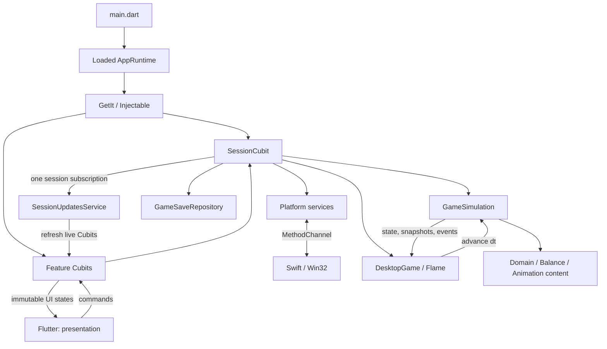

# Idle Companion Architecture

Idle Companion is a desktop idle RPG built with Flutter and Flame for macOS and
Windows. Cubits (`flutter_bloc`) own presentation state; GetIt and Injectable
provide dependencies and generate their registrations. Flutter renders menus and panels; Flame renders the game scene.
The simulation manages combat, progression, and animations. The native layer
provides a transparent window and detects user inactivity.

## Directory tree

The tree below shows the main code and resource directories. Empty directories,
IDE files, and caches are omitted; `build/` is included as the location for temporary outputs.

```text
idle_companion/
├── lib/
│   ├── main.dart                     # Startup, save loading, runtime creation
│   ├── app/                          # Application composition and shared session
│   │   ├── di/                       # GetIt setup, generated Injectable config, scope
│   │   └── session/                  # SessionCubit and SessionUpdatesService
│   ├── core/
│   │   ├── animation/                # Resource types, players, snapshots, markers
│   │   │   └── graph/                # Nodes, transitions, validation, graph execution
│   │   ├── assets/                   # Environment asset paths
│   │   ├── balance/                  # Versioned balance profiles and constants
│   │   ├── numbers/                  # Large numbers, stable math, formatting
│   │   └── persistence/              # Save schema, file repository, instance lock
│   ├── domain/
│   │   ├── activity/                 # Idle levels, rest policy, statistics
│   │   ├── adventure/                # Stage attempt snapshot, checkpoint, reward settlement
│   │   ├── character/                # Character progression and stat calculations
│   │   ├── economy/                  # Reward model
│   │   ├── equipment/                # Equipment catalog and purchase rules
│   │   ├── progression/              # Prices, PurchaseQuote, purchase limits
│   │   ├── talents/                  # Talent catalog, ranks, selection, purchases
│   │   └── settings.dart             # Persisted game settings
│   ├── content/
│   │   └── animations/               # Concrete animation content and registration
│   │       ├── hero/                 # Heroine clips, poses, variants, rest graph
│   │       └── enemies/              # Goblin clips and procedural timelines
│   ├── game/
│   │   ├── desktop_game.dart         # Flame scene, frame loop, simulation updates
│   │   ├── animation/                # Animation coordinators and Flame frame cache
│   │   ├── components/
│   │   │   ├── hero/                 # Character rendering
│   │   │   ├── enemies/              # Enemy rendering
│   │   │   ├── environment/          # Scrolling backgrounds and road
│   │   │   └── effects/              # Hits, damage numbers, reward effects
│   │   └── systems/                  # Simulation, combat state machine, spawning, rewards
│   ├── platform/                     # Dart window/activity interfaces and MethodChannel
│   ├── presentation/                 # Feature ownership, then cubit/ and widgets/
│   │   ├── companion/                # Overlay, game scene and HUD
│   │   │   ├── cubit/                # OverlayCubit and its state
│   │   │   ├── widgets/              # CompanionOverlay, HeroHealthBar
│   │   │   └── hero_return_speech/
│   │   │       ├── cubit/            # Speech state, independent RNG and timer
│   │   │       └── widgets/          # Dialogue bubble
│   │   ├── menu/                     # Main menu and all of its panels
│   │   │   ├── cubit/                # MenuCubit and menu state
│   │   │   ├── widgets/              # Main menu panel
│   │   │   ├── upgrades/
│   │   │   │   ├── equipment/
│   │   │   │   │   ├── cubit/        # EquipmentCubit, quantity and quotes
│   │   │   │   │   └── widgets/      # Equipment panel and item list
│   │   │   │   └── talents/
│   │   │   │       ├── cubit/        # TalentsCubit, selection and quotes
│   │   │   │       └── widgets/      # Talents panel
│   │   │   ├── settings/
│   │   │   │   ├── cubit/            # SettingsCubit and settings state
│   │   │   │   └── widgets/          # Settings panel
│   │   │   ├── statistics/
│   │   │   │   ├── cubit/            # StatisticsCubit and display snapshot
│   │   │   │   └── widgets/          # Statistics panel
│   │   │   └── debug/
│   │   │       ├── cubit/            # DebugCubit and debug state
│   │   │       └── widgets/          # Developer tools panel
│   │   └── recovery/                 # Startup error and recovery flow
│   │       ├── cubit/                # RecoveryCubit, state and factory parameters
│   │       └── widgets/              # Recovery screen
│   └── l10n/                         # ARB, generated localization classes, dialogue list
├── assets/                           # PNGs used by the application
│   ├── characters/hero/              # Runtime heroine sprite sheets
│   ├── enemies/gobli_low/            # Goblin sprites
│   └── environment/                  # Panoramas and road
├── art/                              # Source images and references
│   ├── hero/                         # Canonical references and heroine animation sources
│   └── enemy/gobli_low/              # Goblin source frames
├── tool/
│   └── sprite_assets/                # Python/Dart sprite packing and verification
│       └── manifests/hero/           # JSON frame-packing recipes
├── test/
│   ├── app/                          # DI graph, subscriptions, exit and saving before quit
│   ├── core/                         # Numbers, saves, adventure recovery
│   ├── domain/                       # Talents and purchase contracts
│   ├── game/                         # Combat, boss rewards, talent application
│   ├── presentation/                 # Feature states, provider lifecycle, speech timer
│   └── helpers/                      # Simulation fixtures and runtime service fakes
├── macos/                            # Xcode project and native macOS runner
│   └── Runner/                       # Swift: window, activity, application termination
├── windows/                          # CMake project and native Windows runner
│   └── runner/                       # C++/Win32: window, activity, application termination
├── docs/                             # Architecture, heroine reference, balance status
├── build/                            # Temporary builds, extracted frames, previews
├── pubspec.yaml                      # Dependencies, app version, asset registration
├── pubspec.lock                      # Pinned dependency versions
├── l10n.yaml                         # Localization generation settings
└── README.md                         # Project overview, setup, documentation links
```

## Main modules

| Module | Responsibility |
| --- | --- |
| [`main.dart`](../lib/main.dart) | Initializes Flutter, prevents a second instance from using the same save directory, restores the simulation, and passes the loaded `AppRuntime` to the application dependency scope. |
| [`app/`](../lib/app/) | `CompanionApp` configures the UI. `DependencyScope` owns a GetIt container initialized by generated Injectable registrations. GetIt owns shared singleton Cubits and the updates service; feature `BlocProvider`s own factory Cubits. |
| [`domain/`](../lib/domain/) | Contains game rules and models: stats, purchases, talents, stage attempts, rewards, and rest. Has no Flutter or Flame dependency. |
| [`core/`](../lib/core/) | Provides shared math, the animation engine, balance parameters, and persistence. `GameSave` maps simulation state to JSON. |
| [`content/animations/`](../lib/content/animations/) | Defines installed clips, poses, rigs, and graphs using typed IDs. Concrete content lives here; its execution engine lives in `core/animation/`. |
| [`game/systems/`](../lib/game/systems/) | `GameSimulation` owns the current adventure state. Separate systems handle combat, enemy spawning, and rewards. Runs without Flutter or Flame. |
| [`game/animation/`](../lib/game/animation/) | Coordinators select animations from game state and synchronize their timing with combat and rest. `FlameSpriteFrameCache` loads images for the renderer. |
| [`game/components/`](../lib/game/components/) | Renders simulation state and `PlaybackSnapshot`, scrolls the environment, and displays transient `VisualEvent` effects. |
| [`presentation/`](../lib/presentation/) | Feature folders contain widgets, immutable UI states, and Cubits. Widgets send commands to their feature Cubit and render state through `BlocBuilder`. |
| [`platform/`](../lib/platform/) | Wraps native APIs behind `DesktopWindowService` and `UserActivityService`. Uses the `idle_companion/desktop` channel. |
| [`l10n/`](../lib/l10n/) | Contains the English ARB and generated `AppLocalizations`; `hero_return_lines.dart` collects localized return dialogue. |

## Data flow



1. `main.dart` reads the local save and creates the runtime. A loading failure
   opens the recovery screen instead of starting a new game over corrupted data.
2. `SessionCubit` polls global activity once per second, updates the UI every
   250 ms, and triggers autosave once per minute.
3. `DesktopGame` advances the simulation through its own frame timer.
   `GameSimulation` uses a fixed **1/60 s** step, independent of rendering FPS.
4. Flame components read state and animation snapshots. Damage and rewards
   produce `VisualEvent` instances, which the scene turns into visual effects.
5. Purchases and settings changes go through `EquipmentCubit`, `TalentsCubit`,
   and `SettingsCubit`, then trigger a shared session save. Before exiting,
   `SessionCubit.quit()` pauses the game and waits for the write to finish.
   `close()` only disposes the Cubit, timers, native close handler and lifecycle observer.
6. `OverlayCubit` owns panel navigation and HUD snapshots; `MenuCubit` owns menu
   state. `DebugCubit` owns debug commands. `HeroReturnSpeechCubit` owns the dialogue
   RNG and dismissal timer. `RecoveryCubit` serializes recovery actions and reports errors.
7. `SessionUpdatesService` holds one subscription to the session stream and
   refreshes every registered live feature Cubit. Generated factories call
   `@postConstruct` methods to register each Cubit. The service watches Cubit
   stream completion and removes closed instances automatically. Duplicate
   registration is ignored; disposal cancels all of the service's subscriptions.
8. Every feature Cubit extends the regular `Cubit<State>`. Panels resolve their
   Cubit from GetIt inside `BlocProvider.create`, which closes factory instances
   when the panel leaves the widget tree. Shared `SessionCubit` and `OverlayCubit`
   use `BlocProvider.value`; GetIt disposes them through generated callbacks when
   the dependency scope ends. Local quantity selections and reward expansion
   live in feature Cubits, and the widgets render immutable state snapshots.

## Feature taxonomy

Folders describe ownership first, then implementation. `companion/` owns the
window overlay, game scene, HUD and heroine speech. `menu/` owns the main menu and
its child panels. `menu/upgrades/` groups equipment and talents by purpose.
`recovery/` owns the startup error screen. Each UI feature places its Cubit and
immutable state under `cubit/`, and its panel and helper widgets under `widgets/`.

| Feature | State owner | Widget entry point |
| --- | --- | --- |
| Desktop overlay and panel navigation | [`OverlayCubit`](../lib/presentation/companion/cubit/overlay_cubit.dart) | [`CompanionOverlay`](../lib/presentation/companion/widgets/companion_overlay.dart) |
| Return dialogue | [`HeroReturnSpeechCubit`](../lib/presentation/companion/hero_return_speech/cubit/hero_return_speech_cubit.dart) | [`HeroReturnSpeech`](../lib/presentation/companion/hero_return_speech/widgets/hero_return_speech.dart) |
| Main menu | [`MenuCubit`](../lib/presentation/menu/cubit/menu_cubit.dart) | [`MenuPanel`](../lib/presentation/menu/widgets/menu_panel.dart) |
| Equipment upgrades | [`EquipmentCubit`](../lib/presentation/menu/upgrades/equipment/cubit/equipment_cubit.dart) | [`EquipmentPanel`](../lib/presentation/menu/upgrades/equipment/widgets/equipment_panel.dart) |
| Talent upgrades and selection | [`TalentsCubit`](../lib/presentation/menu/upgrades/talents/cubit/talents_cubit.dart) | [`TalentsPanel`](../lib/presentation/menu/upgrades/talents/widgets/talents_panel.dart) |
| Settings | [`SettingsCubit`](../lib/presentation/menu/settings/cubit/settings_cubit.dart) | [`SettingsPanel`](../lib/presentation/menu/settings/widgets/settings_panel.dart) |
| Activity and combat statistics | [`StatisticsCubit`](../lib/presentation/menu/statistics/cubit/statistics_cubit.dart) | [`StatisticsPanel`](../lib/presentation/menu/statistics/widgets/statistics_panel.dart) |
| Developer tools | [`DebugCubit`](../lib/presentation/menu/debug/cubit/debug_cubit.dart) | [`DebugPanel`](../lib/presentation/menu/debug/widgets/debug_panel.dart) |
| Startup recovery | [`RecoveryCubit`](../lib/presentation/recovery/cubit/recovery_cubit.dart) | [`RecoveryApp`](../lib/presentation/recovery/widgets/recovery_app.dart) |

Cross-feature session coordination belongs to `app/session/`. `SessionCubit`
owns the game instance, activity sampling, autosave, progress reset and exit flow.
`SessionUpdatesService` owns subscription lifecycle and refresh dispatch. It does
not calculate game rules or own feature UI state. Game rules remain in the domain
and simulation; widgets send commands to their Cubit and render its state.

## Dependency injection and lifetimes

[`app/di/injection.dart`](../lib/app/di/injection.dart) creates a new GetIt container
for each dependency scope and calls its generated initializer. Bootstrap supplies
an already loaded `AppRuntime`, containing the simulation, save repository and
platform services. This externally supplied type is the only unregistered type
allowed by the generator; other missing dependencies fail generation.

| Dependency | Registration | Lifetime owner |
| --- | --- | --- |
| `AppRuntime` | Instance supplied by bootstrap | Application dependency scope |
| `SessionCubit` | `@lazySingleton` | GetIt; generated disposal calls `close()` |
| `SessionUpdatesService` | `@lazySingleton` | GetIt; generated disposal calls `dispose()` |
| `OverlayCubit` | `@lazySingleton` | GetIt; generated disposal calls its disposal method |
| Menu, equipment, talents, settings, statistics and debug Cubits | `@injectable` factories | Their feature's `BlocProvider.create` |
| `HeroReturnSpeechCubit` | Parameterized factory | Its `BlocProvider.create`; line count comes from localization |
| `RecoveryCubit` | Parameterized factory | Its `BlocProvider.create`; `RecoveryRequest` supplies startup context |

[`DependencyScope`](../lib/app/di/dependency_scope.dart) exposes the container through
`RepositoryProvider<GetIt>`. Shared Cubits are exposed with `BlocProvider.value`;
the container closes them when the scope ends. Feature panels resolve factory
Cubits through `context.read<GetIt>()<FeatureCubit>()` inside `BlocProvider.create`.
Removing a panel closes its Cubit; reopening it creates a new instance with its
initial local selection state. Factory instances must be closed by their caller
when created outside a widget provider, including in tests.

Recovery can initialize the dependency graph before an `AppRuntime` exists. Its
factory receives the failed load context, retry callback, native window and an
optional repository. It does not resolve the lazy game session or start its timers.

### Centralized session updates

1. The generated factory constructs a feature Cubit with `SessionCubit` and
   `SessionUpdatesService` injected through its constructor.
2. Injectable calls the Cubit's `@postConstruct` method, which registers its
   `refresh` callback with the service. Duplicate registration is ignored.
3. The service holds one subscription to `SessionCubit.stream`. Each session
   update refreshes the currently registered live Cubits. Their `refresh` methods
   copy displayed values and purchase quotes into immutable state snapshots.
4. The service also observes completion of each Cubit's own stream to remove
   its registration automatically after `close()`. Closed Cubits are skipped
   during dispatch; changes to registrations are safe while dispatching updates.
5. Disposing the service cancels the source subscription and lifecycle observers.

The 250 ms session UI clock is separate from Flame's frame loop and the simulation's
fixed step. Feature Cubits do not start another game loop or autosave timer.
Each feature extends the regular `Cubit<State>` and uses composition for services.

### Adding a presentation feature

1. Choose its owning feature and create `cubit/` and `widgets/` beneath that folder.
2. Add an immutable state and a regular Cubit with constructor-injected dependencies.
   Mark the Cubit `@injectable` for a provider-owned factory. Use a shared singleton
   only when its state needs to live for the entire dependency scope.
3. For live game data, inject `SessionUpdatesService` and add a `@postConstruct`
   method that calls `updates.subscribe(this, refresh)`. Keep `refresh` safe after
   closure and copy mutable domain collections into read-only UI snapshots.
4. Create the Cubit in `BlocProvider.create` through GetIt. Render its state with
   `BlocBuilder` and send UI actions back to the feature Cubit. Keep game rules and
   purchase debits in the existing domain and simulation APIs.
5. Regenerate registrations and verify the new lifecycle and behavior.

Run from the repository root after changing dependency annotations or constructors:

```sh
dart run build_runner build
flutter analyze
flutter test
```

[`injection.config.dart`](../lib/app/di/injection.config.dart) is generated and
versioned with its source annotations. Regenerate it instead of editing it manually.
Tests inject fake runtime services through the same generated graph and verify
factory registration, a single session subscription, panel disposal, recovery
without a runtime, and isolation between containers. Source analysis and automated
tests do not prove native window behavior or the final visual appearance.

## Key contracts

**Adventure.** The main loop:

```text
boot → traveling → enemyApproach → combat → enemyDeath → reward → traveling
                                     └──→ heroDeath → respawn → traveling
```

`GameStateMachine` validates allowed transitions. A stage has five waves;
its final wave is a boss. `StageAttempt` snapshots selected talents, their effects,
enemies, nominal rewards, and travel distances. Talent purchases or selection
changes during an attempt apply to the next attempt; equipment changes stats
immediately. `StageSettlement` calculates rewards and limits repeated bonus claims.

**Rest and animations.** Idle levels begin after 30, 120, and 300 seconds of
inactivity. The current encounter finishes before rest begins. `RestCoordinator`
manages policy; the graph runner manages nodes and timing. Movement resumes after
receiving `readyToTravel`. Animation markers determine when combat hits occur.
The renderer consumes the current snapshot without calculating a separate combat timeline.
Rest selection includes seated, phone, and sleeping subtrees. `FadePose` blends
resolved poses with their own rigs; the sleeping graph fades between standing
and bed and reverses four frames with four-second holds on both sides.

**Balance and numbers.** `ProgressionBalance` contains shared combat and progression
coefficients. `EquipmentCurveProfile`, `EconomyProfile`, and `TalentProfile` define
versioned curves. `GameBalance` defines timing and scene geometry.
`Amount` stores large nonnegative values in log10 space; `NumberFormatter` formats
them for the UI. `PurchaseQuote<T>` combines price, actual quantity, effect,
and the reason for a purchase limit.

**Persistence.** `GameSave` stores the character, settings, statistics, stage,
HP, and an unfinished adventure checkpoint. `FileGameSaveRepository` serializes
writes and uses a temporary file and backup. Saves live in the `idle_companion`
subdirectory of the system application support directory obtained through
`path_provider`. Isolated runs can use
`--dart-define=IDLE_COMPANION_SAVE_DIRECTORY=...`.
There are no rewards while the app is closed; gaps longer than 5 seconds are not simulated.

**Native window.** Swift and Win32 manage transparency, always-on-top behavior,
click regions, and close requests. Native and Flutter interaction regions must
match. macOS uses a transparent window; Windows uses the `RGB(1,1,1)` color key.
Activity detection reads idle duration without recording input contents.

## Where to make changes

| Change | Main locations |
| --- | --- |
| Economy or stats | `core/balance/`, `domain/character/`, `domain/progression/` |
| Equipment or talents | `domain/equipment/`, `domain/talents/`, `presentation/menu/upgrades/` |
| Combat, enemies, or rewards | `game/systems/`, `domain/adventure/`, `domain/economy/` |
| Clips or rest | `content/animations/`, coordinators in `game/animation/`, policy in `domain/activity/` |
| UI or dialogue | Owning `presentation/` feature; dialogue in `presentation/companion/hero_return_speech/`; `lib/l10n/app_en.arb` and `flutter gen-l10n` |
| Dependency graph or lifetimes | `app/di/`, feature annotations; regenerate `injection.config.dart` |
| Shared UI refresh, saves or session lifecycle | `app/session/`; feature UI state stays in its own Cubit |
| Window or global activity | `platform/`, `macos/Runner/`, `windows/runner/` |
| Save schema or recovery | `core/persistence/`, `domain/adventure/`, recovery logic in `GameSimulation` |
| New PNGs | Sources in `art/`, packing in `tool/sprite_assets/`, output in `assets/`, registration in `pubspec.yaml` and animation content |

Keep game rules and calculations in the domain and simulation layers. The UI
displays their results; native calls go through platform services.
Keep sources and references in `art/`, and temporary frames and previews in `build/`.
Tests in `test/` cover critical regressions: numbers, purchases, combat, rewards,
persistence, and recovery. Visual and native behavior require separate validation
on the corresponding OS.

Further reading: [sprite tools](../tool/sprite_assets/README.md),
[heroine reference](hero_reference.md),
[current balance status](balance_refactoring_summary.md).
